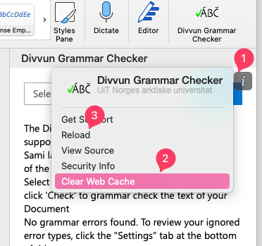

# Sami Grammar Checker for MS Office Online

The grammar checker is an add-on to MS Office Online and more specifically Word.

# Requirements

- Node.js (> 10.0)
- npm

You will also need to add the self-signed certificate to your chain of trust. If you're using Chrome/Safari for Windows or macOS you can follow the instructions here: https://github.com/OfficeDev/generator-office/blob/master/src/docs/ssl.md
If you're using Firefox you can go to `Preferences` > `Privacy & Security`, then scroll to the bottom and under the `Certificates` section click on the `View Certificates` button. In the opened modal window, under the `Authorities` tab,
click `Import...` and select the file `certs/ca.crt`.

# Development setup

Steps to run this in a development environment:

1. npm install
2. npm start

When this inevitably fails, may we suggest accepting our lord and saviour docker into your hearts and going

```bash
docker run --platform linux/amd64 --rm -ti -p 3000:3000 -v $(pwd):/app node:10 bash
# cd /app
# npm install
# npm start
```

This will have you running a local server at port 3000. Then depending on which Word you want to test,
you need to provide the `manifest.xml` file to Word in a different way.

### Certificates

It's probable that the included certificates won't work for your local dev environment. If, after adding the cert to Firefox, you still get a security threat warning, or if you notice that double-clicking the `ca.crt` to add it to your keychain does absolutely nothing, it's time to generate your own:

```bash
# make new dir for your new certs
mkdir certs2
cd certs2

# generate a CA private key
openssl genrsa -out ca.key 2048

# create the CA cert
openssl req -x509 -new -nodes -key ca.key -sha256 -days 1024 -out ca.crt \
    -subj "/C=US/ST=State/L=City/O=YourOrganization/OU=Dev/CN=Localhost-CA"

# generate server private key
openssl genrsa -out server.key 2048

# create cert signing request (CSR)
openssl req -new -key server.key -out server.csr \
    -subj "/C=US/ST=State/L=City/O=YourOrganization/OU=Dev/CN=localhost"

# create SAN config file
vim server.ext

# and copy the below into that file:
# begin server.ext
authorityKeyIdentifier=keyid,issuer
basicConstraints=CA:FALSE
keyUsage = digitalSignature, nonRepudiation, keyEncipherment, dataEncipherment
extendedKeyUsage = serverAuth
subjectAltName = @alt_names

[alt_names]
DNS.1 = localhost
# end of server.ext

# sign the server certificate with the CA
openssl x509 -req -in server.csr -CA ca.crt -CAkey ca.key -CAcreateserial \
    -out server.crt -days 500 -sha256 -extfile server.ext
```

Now, update `config/webpack.dev.js` to point to the new certs you just created in `certs2/`.

Make sure you do the step to trust the `ca.crt` you just created, as outlined above.

## Online

You need to upload the manifest file in order to test the add-in. Follow the instructions on https://docs.microsoft.com/en-us/office/dev/add-ins/testing/sideload-office-add-ins-for-testing#sideload-an-office-add-in-in-office-online

## iPad and Mac

In order to provide your `manifest.xml` follow these instructions:
https://docs.microsoft.com/en-us/office/dev/add-ins/testing/sideload-an-office-add-in-on-ipad-and-mac

If you want to debug on the iPad or Mac, follow these instructions to get access to some debug tools and the console:
https://docs.microsoft.com/en-us/office/dev/add-ins/testing/debug-office-add-ins-on-ipad-and-mac


# Publishing

The [Divviun Grammar Checker](https://appsource.microsoft.com/en-us/product/office/WA200001000?tab=Overview) is published at [Microsoft Partner Center](https://partner.microsoft.com/nb-no/dashboard/office/products/c280f9cf-93a4-4916-b322-f6d3c13d955a/setup). You'll need to login with divvunuit@gmail.com

There's a checklist of stuff to do before publishing - it lives [here](https://learn.microsoft.com/en-us/partner-center/marketplace/checklist). Saying that as a reference only. Technically there shouldn't be much more stuff in here.

Unlike google docs, the microsoft add-in:s are hosted by us. We provide Microsoft with a manifest that points at a URL we control — https://api.giellalt.org/msoffice/index.html — so **a content-only update needs no Partner Center resubmission**. Only changes to the URLs, permissions or the add-in id require going back to Microsoft.

## Where the files are served from

Traefik serves them itself, using the [statiq](https://github.com/hhftechnology/statiq) filesystem plugin. There is no backend application in the path:

```
https://api.giellalt.org/msoffice/*
  -> IngressRoute api-giellalt-https           (k0s-config: ingress/api-giellalt-ingress.yaml)
  -> msoffice-root-redirect, strip-msoffice-prefix, statiq-msoffice
                                               (k0s-config: ingress/statiq-msoffice-middleware.yaml)
  -> statiq reads /msoffice inside the Traefik pod
  -> NFS divvun-cp:/srv/nfs/pahkat/msoffice    (k0s-config: apps/infrastructure/traefik-app.yaml)
```

`api-giellalt.uit.no` is still matched on the same route, so both hostnames serve the same files.

The `divvun-worker-static-prod` service named in the route is a formality — statiq terminates the request and that service is never reached.

## Deploying

Build (any recent Node; the old `node:10` container is no longer needed):

```bash
npm install
npm run build
```

That leaves the add-in in `dist/`. Publishing it is a **manual copy** — there is no CI job, ArgoCD sync or script that does this for you.

The share is normally mounted locally as `/Volumes/pahkat`, so deploying is just:

```bash
cp -R dist/ /Volumes/pahkat/msoffice/
```

Copy **over the top; do not wipe the directory first.** `index.html` is cached by clients for a day (see below), so browsers still holding the previous `index.html` need the previous hashed bundles to remain in place. That is why several `app.<hash>.js` files accumulate there — it is intentional, and they can be pruned once they are well past the cache window.

If the share is not mounted, write it on `divvun-cp` instead — the NFS export is mounted `readOnly` into the Traefik pods and Traefik runs as uid 65534, so it cannot be written through the pod:

```bash
tar czf dist.tar.gz -C dist .
scp dist.tar.gz divvun-cp:/tmp/
ssh divvun-cp 'tar xzf /tmp/dist.tar.gz -C /srv/nfs/pahkat/msoffice'
rm dist.tar.gz
```

No Traefik restart is needed — statiq reads from disk per request.

**`index.html` is served with `cache-control: max-age=86400`**, so a warmed client can keep showing the old build for up to 24 hours. Clear the Word web cache (below) when verifying a deploy.

There is no beta channel for the add-in itself: `beta.api.giellalt.org/msoffice/` does not exist. The "Use Beta API" setting only switches which API the same bundle talks to.

Remember to run your tests with the cache disabled. When in word, hover the grammar checker until the "i" appears __(1)__, click it and then clear the web cache __(2)__ and reload __(3)__ in the menu that appears:


